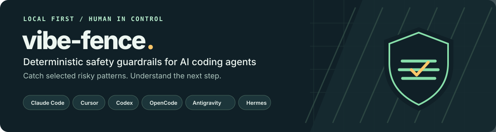
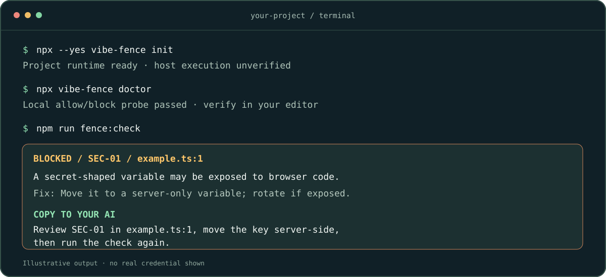
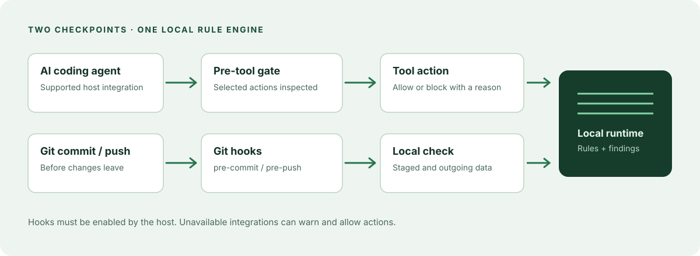

<p align="center">
  
</p>

<p align="center">
  <a href="https://github.com/poferraz/vibe-fence/actions/workflows/ci.yml"></a>
  <a href="https://www.npmjs.com/package/vibe-fence"></a>
  <a href="LICENSE"></a>
  
  
</p>

# A safety net for AI-assisted coding

vibe-fence checks selected risky patterns in coding-agent actions and Git changes, then explains findings in plain language. It runs locally, and its deterministic checks don't require an AI model.



## Get started

You need **Node.js 20 or newer** and Git. Choose the coding tool you use and run one command in your project:

```sh
npx --yes vibe-fence@latest init --host=codex
```

Replace `codex` with `claude`, `cursor`, `opencode`, `antigravity`, or `hermes`. Use `none` for Git checks alone. If exactly one tool is already configured in the project, `init` can detect it; otherwise it asks you to name it before writing anything. Global editor installations do not select a project tool.

Setup installs the selected integration and project-local runtime, adds Git checks, and runs the available local hook self-test. Follow your tool's restart and project trust prompt. The self-test checks the installed script; actual editor execution remains unverified until observed. Antigravity and Hermes provide guidance only. No account, API key, model selection, service connection, or separate diagnostic command is required.

For a reproducible install, use `npx --yes vibe-fence@0.5.0 init --host=codex`. See the source-build instructions below for development.

Commits inspect **staged content only**. Pushes inspect **outgoing history only**, including a leak removed in a later outgoing commit. Unrelated untracked files and unstaged drafts cannot block those operations. To review the whole project explicitly, run:

```sh
node ./.fence/bin/vibe-fence.cjs check
```

The runtime stays in the project, so checks do not depend on the `npx` cache. In projects with a `package.json`, setup adds `fence:check`, `fence:status`, and `fence:undo` scripts unless the names already exist. Use `--no-package-scripts` to skip these shortcuts.

`status` shows what is configured; optional `doctor` reruns local diagnostics. Neither can prove the editor loaded a hook. Some integrations allow an action when the checker is unavailable; Git hooks can be bypassed. A new clone or machine needs its own setup.

## What it looks for

Checks are pattern-based and bounded. A clean result means the inspected inputs matched none of the supported patterns; it is not proof that a project is secure.

| Rule | Risk in plain language | Example pattern | Default action |
|---|---|---|---|
| **SEC-01** | A browser-visible variable may expose a secret | `NEXT_PUBLIC_` plus a secret-shaped name | Block |
| **SEC-02** | An agent may read a credential file | Reading `.env` or an SSH private-key path | Block |
| **SEC-03** | A credential may enter Git history | A recognized live token or a tracked `.env` | Block |
| **BILL-01** | A loop may make unbounded paid calls | A recursive timer that repeatedly calls an API | Warn in scans; the separate observed network-command cap can block |
| **CMD-01** | A command may destroy files or permissions | `rm -rf /` | Block |
| **DB-01** | A database change may destroy data or weaken RLS | `DROP TABLE` or disabling row-level security | Block |
| **FS-01** | A file operation may escape the project | A path resolving outside the project | Block |
| **GIT-01** | A Git command may discard or overwrite work | `git reset --hard` | Block |
| **NET-01** | Downloaded code may be executed without review | `curl … \| sh` | Block |
| **PRV-09** | Test data may contain real personal information | Recognized sensitive data in a fixture | Block |
| **SUP-01** | Package installation may execute unsafe scripts | A suspicious lifecycle script or an unguarded install | Block |

The pre-tool gate evaluates a subset of rules for supported tool calls; worktree, staged and outgoing-history scans cover other patterns. Package-script expansion is a bounded heuristic, not a complete shell interpreter. See [evidence and known gaps](docs/EVIDENCE.md).

## Supported coding agents

| Host | Integration | What to verify |
|---|---|---|
| Claude Code | Project `PreToolUse` hook | Trust and exercise the hook in a real session |
| Cursor | Project `preToolUse` hook | Exercise the hook in a real session |
| Codex | Project pre-tool hook for supported actions | Enable and exercise the hook in a real session |
| OpenCode | Project `tool.execute.before` plugin | Confirm that the host loads the plugin |
| Antigravity | Project guidance and skills | Advisory only; no tool-call block is claimed |
| Hermes | Project guidance and skills | Advisory only; no tool-call block is claimed |

Claude Code, Cursor and Codex hook scripts use Node.js; `jq` is not required. The hooks do not cover every action or tool. Git checks depend on the effective hooks directory and the availability of the local runtime.



## Recover and learn

When a finding blocks a change, the terminal shows what happened, a suggested fix and a prompt you can copy into your coding assistant. The repair text is generated locally without a model. For advanced control over its length:

```sh
npx vibe-fence dial max       # also: medium, min, silent, status
```

Before a larger change, save a local checkpoint and undo it if needed:

```sh
npx vibe-fence checkpoint --action "before changing the database"
npx vibe-fence undo
```

Checkpoints perform a bounded secret pre-check before staging. A detected secret blocks the checkpoint; `--allow-secrets-in-checkpoint` is an explicit override. Detection is not exhaustive: concurrent edits or Git clean filters can still put a blob into local object storage before the staged check rejects the commit. Never rely on a checkpoint to safely store credentials.

`undo` preserves work in the index when it can soft-reset an unpushed checkpoint; otherwise it creates a revert commit. It does not erase secrets from Git history.

## Command reference

| Command | Purpose |
|---|---|
| `init [--host=tool] [--no-package-scripts] [--dry-run]` | Set up one tool and Git checks; run local diagnostics |
| `status [--host=name] [--adapters=a,b] [--json]` | Inspect configuration, local integrity and Git hooks |
| `doctor [--host=name] [--json]` | Run local allow/block probes and report their limits |
| `check [--json] [--staged] [--push [range] \| --all]` | Scan the worktree, index, or outgoing history |
| `check --max-bytes N --max-files N` | Set per-file and file-count limits |
| `checkpoint --action <label> [--include-untracked] [--allow-secrets-in-checkpoint]` | Create a local undo point |
| `undo [--steps N]` | Undo checkpoint commits without a force push |
| `dial [max\|medium\|min\|silent\|status]` | Set or inspect teaching level |
| `reset` | Reset the circuit breaker and observed network-command counter |
| `verify [--json]` | Run configured local project checks |
| `uninstall [--dry-run]` | Restore unchanged managed files and earlier Git hooks; `remove` is an alias |
| `gate --tool <name> --args-stdin [--root <dir>]` | Evaluate one host tool call |

For `check`, exit **0** means no blocking findings in the inspected inputs, **1** means a policy block, and **2** means the scan was incomplete or the command was invalid. If a report has both a policy block and an incomplete scan, it returns 1 and reports both. Unknown findings need review.

Create `.fenceignore` in the project root to exclude paths with simple globs or prefixes. Common lockfiles, minified JS, source maps and binary media are skipped by default. **Excluded paths are not inspected**, including when scanning staged or outgoing history. Tracked `.env` files cannot be hidden by `.fenceignore`. An oversized eligible file produces exit 2 and identifies the path; review it before increasing `--max-bytes` or excluding it.

The network-command guard counts selected shell invocations in a local rolling window (default: 100 per hour); it cannot see every request or measure cloud spending. Set `billing_guard.max_calls` and `billing_guard.window_ms` in `.fence/config.json` to adjust it, then re-run `init` to refresh the local integrity baseline.

<details>
<summary>If a secret was committed or exposed</summary>

1. Revoke or rotate the credential with its provider immediately.
2. Remove it from source and store a replacement in a Git-ignored, server-only location.
3. Before pushing, run `npx vibe-fence check --push --all` and review the affected history.

Deleting a file or running `undo` does not erase an existing Git object or reverse an exposure. The scanner detects selected token shapes; it can miss credentials. Follow the provider's incident guidance.

</details>

<details>
<summary>Protection states and verification limits</summary>

`configured-unverified` means the expected local configuration is present, not that the host executed it. `advisory` means guidance does not block tool calls; `degraded` means required pieces are missing or changed; `inactive` or `unverified` means protection is absent or cannot be established. Run `doctor`, then test the actual host in a disposable project.

The integrity manifest detects local changes to selected instructions, host configuration, launchers and the active runtime. An agent or user who can write the project can also change the manifest, so it is not an independent trust boundary. Scan limits, unsupported inputs, excluded files and fail-open integrations remain important boundaries.

`verify` runs the project's configured lint, test and build scripts and stores their output under `.fence/verdicts/`; review those scripts and logs. A missing command or result is `unknown`, not a pass. Running application scripts can have their own effects; Fence's own checks make no service requests.

Model clients, API keys, contributor settings, demo profiles and remote database probes have been removed. Re-run `init --host=<tool>` to refresh an existing project's runtime, hooks and managed configuration. Existing host integrations and user edits are preserved; setup does not silently remove previously installed adapters. The old `--explain` option is accepted for local compatibility and makes no additional request.

</details>

<details>
<summary>Uninstalling vibe-fence</summary>

Run `npx vibe-fence uninstall --dry-run` to review the planned removals, then `npx vibe-fence uninstall`. The command restores unchanged files from its local install record, removes managed hooks and restores `.pre-fence` backups. It preserves later edits and unknown files, and reports anything that needs manual review. Older installations without a safe removal record are left unchanged.

The private, Git-ignored `.fence/uninstall.json` record may contain prior contents of files changed during installation. The installer avoids copying settings that appear to contain credentials, but that heuristic is not exhaustive. Review the record before sharing the project. Removing vibe-fence does not remove credentials from Git history.

</details>

<details>
<summary>Build from source, contributing and provenance</summary>

### Build from source

Building this repository requires Bun. The installed CLI itself runs on Node.js.

```sh
bun install --frozen-lockfile
bun run build
# In a project folder, using the absolute path to this checkout:
node /path/to/vibe-fence/dist/cli.js init
```

`src/` is the source of truth and `dist/` is generated. The verification gate is:

```sh
bunx --no-install tsc --noEmit
bun run build
bun run validate
bun test
bun run eval
bun pm pack --dry-run
```

See the [maintainer guide](docs/MAINTAINER.md), [documentation index](docs/fence/INDEX.md), [evidence](docs/EVIDENCE.md) and [build provenance](docs/BUILD-PROVENANCE.md).

</details>

## License

[MIT](LICENSE).
