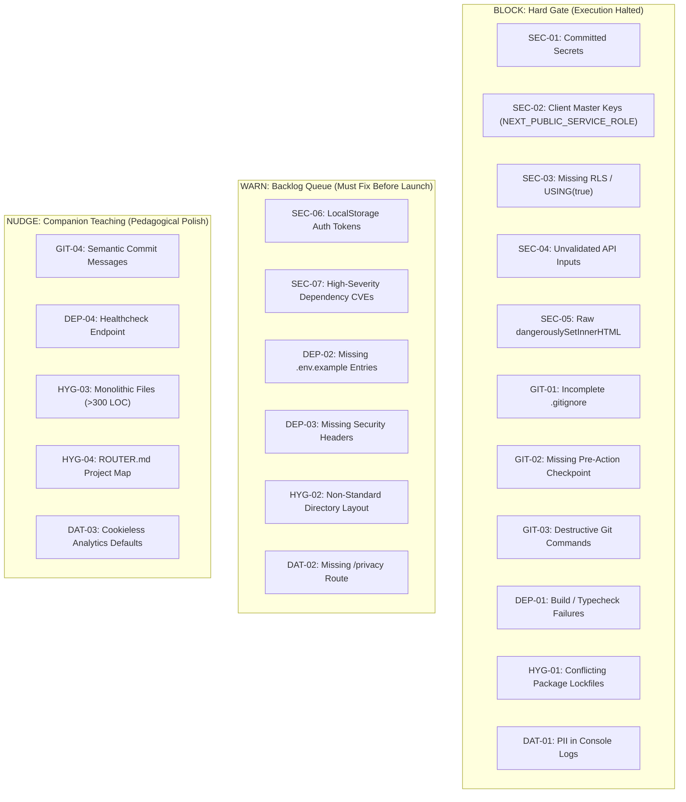

# Stream 04: Developer Guardrails — Research Report

- **Model:** Gemini 3.8 Flash
- **Provider:** Google DeepMind (Antigravity)
- **Date:** 2026-10-20
- **Stream:** 04 — Developer Guardrails (Rights & Wrongs)

---

## Executive Summary

Non-technical "vibe-coders" cannot evaluate architectural safety, cryptographic standards, or deployment prerequisites. When an AI agent encounters a permission or type error, its default alignment incentive is to *make the error disappear immediately*—often by disabling security checks, exposing master admin keys in frontend bundles, or setting database row-level security to `USING (true)`.

`vibe-fence` must act as an objective, non-negotiable floor of engineering hygiene. The user should never have to make a security decision; the harness structurally enforces correctness while companioning the user with plain-English explanations.

This report catalogs the objective rights and wrongs of modern web development across five domains:
1. **Security** (OWASP Top 10, Secrets, Auth, Database RLS, Dependency Audits)
2. **Git & GitHub Hygiene** (Checkpoints, `.gitignore`, Commit Conventions, Pre-commit Hooks)
3. **Deploy & Production Readiness** (Build Checks, Environment Parity, HTTPS/Headers, Public vs Private Keys)
4. **Project Hygiene** (Directory Topology, Package Manager Locking, File Size Ceilings)
5. **Data & Privacy** (PII Logging, GDPR-Lite, Cookieless Analytics Defaults)

Each guardrail is assigned an objective severity:
- **`block`**: Absolute gate. The harness halts the agent, prevents the commit, and refuses to ship until satisfied.
- **`warn`**: Action required before public release; flagged in `.fence/queue.json` as an automated backlog item.
- **`nudge`**: Architectural best practice; gently suggested when appropriate.

---

## Guardrails Catalog

---

### Category 1: Security & Vulnerability Guardrails

| ID | Rule | Why it matters | How to auto-enforce | What to teach the user | Severity | Source |
|---|---|---|---|---|:---:|---|
| **SEC-01** | **Zero Secrets in Git History** | Once pushed to a public or private repo, compromised API keys are scraped by bots in under 60 seconds, resulting in drained credit cards and compromised databases. | Pre-commit regex hook (Gitleaks pattern) + automated `.env*` exclusion in git staging. | *"We blocked saving a private API password into your code history so it can never be stolen."* | **`block`** | [Gitleaks / GitHub Secret Scanning](https://github.com/gitleaks/gitleaks) |
| **SEC-02** | **No Master Secrets in Client Bundles** | Prefixing variables with `NEXT_PUBLIC_` or `VITE_` injects them directly into the browser JS bundle. AI models regularly prefix `service_role` keys with `NEXT_PUBLIC_` to bypass permission errors. | Static AST linter check scanning for forbidden keywords (`SERVICE_ROLE`, `SECRET`, `PRIVATE_KEY`) paired with public framework prefixes. | *"Your app was trying to give website visitors the master admin key to your database. We kept it private on your secure server instead."* | **`block`** | [Supabase Security Advisor / Vercel Docs](https://vercel.com/docs/security) |
| **SEC-03** | **Enforce Table-Level RLS & Ban Permissive Policies** | Without Row Level Security (RLS), anyone with the public `anon` key can read, update, and delete every row in the database. AI models frequently write `USING (true)` to clear permission bugs. | Static SQL / Migration linter rejecting table creations lacking `ALTER TABLE ... ENABLE ROW LEVEL SECURITY;` or containing `FOR ALL USING (true);`. | *"We locked your database so users can only view and edit their own private data, not everyone else's."* | **`block`** | [OWASP A01:2021 — Broken Access Control](https://owasp.org/Top10/A01_2021-Broken_Access_Control/) |
| **SEC-04** | **Strict Runtime Input Schema Validation** | Unvalidated API routes and Server Actions allow SQL/NoSQL injection, unexpected prototype pollution, and malformed state corruption. | TypeScript linter rule mandating runtime schema validation (Zod, Valibot) on all route handler parameters and server actions. | *"We added a bouncer at the door of your database to inspect incoming requests and reject weird or malicious inputs."* | **`block`** | [OWASP A03:2021 — Injection](https://owasp.org/Top10/A03_2021-Injection/) |
| **SEC-05** | **Ban Raw `dangerouslySetInnerHTML`** | Unsanitized HTML rendering allows attackers to inject malicious scripts (Cross-Site Scripting - XSS) that hijack user sessions. | ESLint `react/no-danger` check; only permit if wrapped in `DOMPurify.sanitize()`. | *"We stopped the page from running unverified code that could let bad actors tamper with user accounts."* | **`block`** | [OWASP A03:2021 — XSS](https://owasp.org/Top10/A03_2021-Injection/) |
| **SEC-06** | **Auth Sessions in HTTP-Only Cookies (Ban `localStorage` Tokens)** | JWTs or session tokens stored in browser `localStorage` can be stolen by any third-party script or browser extension via XSS. | ESLint rule detecting storage of tokens in `localStorage` or `sessionStorage` in client components. | *"We moved user login passes into a sealed digital vault (HTTP-only cookies) that hacker scripts cannot read."* | **`warn`** | [OWASP A07:2021 — Identification & Auth](https://owasp.org/Top10/A07_2021-Identification_and_Authentication_Failures/) |
| **SEC-07** | **Automated Dependency Vulnerability Scanning** | Third-party packages frequently contain known high/critical exploits (supply chain poisoning, prototype pollution). | `npm audit --audit-level=high` pre-push check. | *"A helper library your app uses has a known security hole. We flagged it to update to a safe version."* | **`warn`** | [OWASP A06:2021 — Vulnerable Components](https://owasp.org/Top10/A06_2021-Vulnerable_and_Outdated_Components/) |

---

### Category 2: Git & Version Control Hygiene

| ID | Rule | Why it matters | How to auto-enforce | What to teach the user | Severity | Source |
|---|---|---|---|---|:---:|---|
| **GIT-01** | **Mandatory `.gitignore` Invariants** | Missing `.gitignore` entries causes developers to accidentally commit gigabytes of `node_modules`, secret `.env.local` files, and OS junk like `.DS_Store`. | `vibe-init` scaffold check: writes canonical `.gitignore` and locks it against removal. | *"We set up an invisibility cloak for sensitive and temporary files so they never get uploaded to the cloud."* | **`block`** | [GitHub Gitignore Documentation](https://docs.github.com/en/get-started/getting-started-with-git/ignoring-files) |
| **GIT-02** | **Deterministic Pre-Action Checkpoint Commits** | AI agents often break entire files during refactoring; without local checkpoints, non-technical users lose hours of work with no way to undo. | Harness wrapper executes `git add . && git commit -m "checkpoint: [action]"` immediately before firing multi-file edits. | *"We saved a snapshot of your project before making this change, so you can press 'Undo' at any moment if you don't like it."* | **`block`** | [Aider Git Architecture](https://aider.chat) |
| **GIT-03** | **Ban Destructive Git Commands (`push --force`, `reset --hard`)** | Force pushes and hard resets permanently wipe commit histories and destroy recovery checkpoints. | Intercept shell command execution in the harness ACI; reject any command containing `--force`, `-f`, or `reset --hard`. | *"We blocked a command that would permanently erase your project history."* | **`block`** | [GitHub Branch Protection Docs](https://docs.github.com) |
| **GIT-04** | **Standardized Semantic Commit Messages** | Unstructured commits like "update" or "asdf" make it impossible to track down when bugs were introduced or auto-generate changelogs. | Agent prompt instruction + pre-commit commit-msg hook enforcing Conventional Commits (`feat:`, `fix:`, `checkpoint:`). | *"We labeled this save neatly so you can always see exactly what changed and when."* | **`nudge`** | [Conventional Commits 1.0.0](https://www.conventionalcommits.org) |

---

### Category 3: Deployment & Production Readiness

| ID | Rule | Why it matters | How to auto-enforce | What to teach the user | Severity | Source |
|---|---|---|---|---|:---:|---|
| **DEP-01** | **Pre-Push Typecheck & Build Verification** | Pushing code that fails TypeScript compilation or build bundling breaks the live production site and causes failed Vercel deployments. | Pre-push verification executing `npm run build` or `tsc --noEmit`. Commit rejected if exit code $\ne 0$. | *"We checked that your website actually builds properly before uploading it, preventing your live site from crashing."* | **`block`** | [Vercel Production Checklist](https://vercel.com/docs/production-checklist) |
| **DEP-02** | **Synchronized Environment Variable Templates (`.env.example`)** | When an agent adds a new API key to `.env.local`, production builds on Vercel crash because the key is missing from Vercel's project dashboard. | Harness post-edit hook: whenever `.env.local` is modified, automatically mirror variable keys (with empty dummy values) to `.env.example`. | *"We noted a new setting in `.env.example` so you remember to add it to your Vercel live settings."* | **`warn`** | [12-Factor App: Config](https://12factor.net/config) |
| **DEP-03** | **Standard Security Headers Configured** | Web apps lacking security headers are vulnerable to clickjacking (`iframe` embedding), MIME-type sniffing, and downgrade attacks. | Scaffold `next.config.js` or middleware with default security headers (`X-Frame-Options: DENY`, `X-Content-Type-Options: nosniff`, `Referrer-Policy`). | *"We put security shields on your website headers to prevent other sites from stealing your design in an iframe."* | **`warn`** | [MDN Web Security Guidelines](https://developer.mozilla.org/en-US/docs/Web/HTTP/Headers) |
| **DEP-04** | **Basic Healthcheck Route (`/api/health`)** | Without a lightweight healthcheck endpoint, external monitoring tools cannot verify if the application database and serverless functions are responsive. | Scaffold `/api/health` route returning `{ status: "ok", timestamp: ... }`. | *"We gave your app a digital pulse monitor so you can instantly tell if your site is online."* | **`nudge`** | [Vercel Deployment Health](https://vercel.com/docs) |

---

### Category 4: Project Structure & Hygiene

| ID | Rule | Why it matters | How to auto-enforce | What to teach the user | Severity | Source |
|---|---|---|---|---|:---:|---|
| **HYG-01** | **Single Lockfile Consistency** | Having multiple lockfiles (`package-lock.json` and `yarn.lock` or `pnpm-lock.yaml`) causes erratic dependency versions, silent build breaks, and deployment mismatches. | Pre-action check detects conflicting lockfiles and removes redundant ones based on user's active package manager. | *"We cleaned up conflicting package manager files so your app always installs the exact same software in production."* | **`block`** | [npm Documentation](https://docs.npmjs.com) |
| **HYG-02** | **Canonical Folder Topology** | When agents place components and utilities randomly across the root directory, files get lost, dependencies cycle, and models lose context awareness. | Scaffold and enforce standard directory paths: `src/app/`, `src/components/ui/`, `src/lib/`, `src/types/`. | *"We kept all your building blocks organized in their proper folders so nothing gets lost as your project grows."* | **`warn`** | [Next.js Project Organization](https://nextjs.org/docs/app/building-your-application/routing/colocation) |
| **HYG-03** | **File Size Ceiling (< 300 Lines of Code)** | Monolithic 800-line files exceed high-attention context limits, causing models to hallucinate or accidentally delete surrounding code when editing. | Linter warning when a single component exceeds 300 LOC, prompting the agent to decompose it into modular subcomponents. | *"This file was getting too long and complicated for the AI to edit safely, so we split it into clean, bite-sized pieces."* | **`nudge`** | [Clean Code Principles](https://clean-code-developer.com) |
| **HYG-04** | **Machine-Readable Project Map (`ROUTER.md`)** | As repos grow, agents waste dozens of tool turns exploring files to find where functions live. | Harness automatically generates and updates `.fence/ROUTER.md` indexing active routes and data schemas. | *"We keep an up-to-date roadmap of your project so the AI always knows where everything lives instantly."* | **`nudge`** | [vibe-fence Specification](file:///Users/poferraz/Documents/Development/active/vibe-fence/docs/PLAN.md) |

---

### Category 5: Data, Privacy & Compliance

| ID | Rule | Why it matters | How to auto-enforce | What to teach the user | Severity | Source |
|---|---|---|---|---|:---:|---|
| **DAT-01** | **Zero PII & Credentials in Server Logs** | Logging `console.log(req.body)` dumps plaintext passwords, credit card tokens, and emails into server log aggregators (Datadog, Vercel Logs), causing severe compliance breaches. | ESLint custom rule flagging `console.log` statements containing sensitive variable names (`password`, `token`, `secret`, `body`). | *"We blocked logging user passwords and emails into server records, protecting user privacy."* | **`block`** | [OWASP A09:2021 — Logging & Monitoring](https://owasp.org/Top10/A09_2021-Security_Logging_and_Monitoring_Failures/) |
| **DAT-02** | **Mandatory Privacy Policy Route (`/privacy`)** | Web apps collecting user emails, payments, or analytics without a disclosed privacy policy violate app store terms and basic consumer privacy regulations (GDPR/CCPA). | Scaffold a clean, template-driven `/privacy` page during `vibe-init`, customized to declared service providers (Supabase, Stripe, etc.). | *"We generated a simple privacy policy page explaining how user data is handled, keeping your app legal."* | **`warn`** | [GDPR Article 13 & 14 / FTC Guidelines](https://gdpr-info.eu/art-13-gdpr/) |
| **DAT-03** | **Cookieless Analytics Default** | Traditional cookie-based trackers require invasive, annoying cookie-consent popups that ruin UX and bounce visitors. | Pre-configure modern cookieless analytics defaults (e.g. Vercel Web Analytics, Plausible, or PostHog cookieless mode). | *"We set up lightweight website analytics that respect visitor privacy without needing an annoying cookie popup banner."* | **`nudge`** | [ePrivacy Directive / GDPR Compliance](https://gdpr.eu/cookies/) |

---

## Severity Architecture Summary



---

## Coverage Gaps & Practical Nuances

1. **Static AST Analysis vs Dynamic Database Policies:** Static analysis can verify that SQL migration files contain `ENABLE ROW LEVEL SECURITY`, but it cannot verify whether a remote Supabase instance already created tables through the web dashboard without RLS. A complete harness must inspect live remote schemas via an MCP server or API check.
2. **False Positives in Secret Scanning:** High-entropy string detectors (like standard Gitleaks rules) occasionally flag public asset hashes or base64 SVG icons. The harness must maintain a deterministic allowlist for verified false positives.
3. **Framework Divergence (Next.js vs Vite/SPA vs Remix):** While `NEXT_PUBLIC_` is standard in Next.js, Vite uses `VITE_` and Astro uses `PUBLIC_`. The harness adapter layer must dynamically configure the appropriate prefix scanner depending on the detected framework.

---

## Sources

| # | Source URL | Type | Accessed |
|---|---|---|---|
| 1 | [https://owasp.org/Top10/](https://owasp.org/Top10/) — OWASP Top 10 Web Application Security Risks | Official Standards | 2026-10-20 |
| 2 | [https://vercel.com/docs/security](https://vercel.com/docs/security) — Vercel Platform Security Overview | Official Docs | 2026-10-20 |
| 3 | [https://vercel.com/docs/production-checklist](https://vercel.com/docs/production-checklist) — Vercel Production Checklist | Official Docs | 2026-10-20 |
| 4 | [https://github.com/gitleaks/gitleaks](https://github.com/gitleaks/gitleaks) — Gitleaks Secret Scanner | GitHub Repository | 2026-10-20 |
| 5 | [https://supabase.com/docs/guides/auth/row-level-security](https://supabase.com/docs/guides/auth/row-level-security) — Supabase RLS Guidelines | Official Docs | 2026-10-20 |
| 6 | [https://developer.mozilla.org/en-US/docs/Web/HTTP/Headers](https://developer.mozilla.org/en-US/docs/Web/HTTP/Headers) — MDN Web Security Headers | Official Docs | 2026-10-20 |
| 7 | [https://docs.github.com/en/get-started/getting-started-with-git/ignoring-files](https://docs.github.com) — GitHub Gitignore Specs | Official Docs | 2026-10-20 |
| 8 | [https://12factor.net/config](https://12factor.net/config) — The Twelve-Factor App: Config | Architecture Standard| 2026-10-20 |
| 9 | [https://www.conventionalcommits.org/](https://www.conventionalcommits.org/) — Conventional Commits Specification | Standards Specification| 2026-10-20 |
| 10 | [https://gdpr-info.eu/](https://gdpr-info.eu/) — General Data Protection Regulation (GDPR) Portal | Legal Specification | 2026-10-20 |

---

## Implications for vibe-fence

### 1. What to Implement in Phase 1 (Core Scaffold)

1. **The "Fence Invariants" Pre-Commit Interceptor (`.fence/hooks/pre-commit`):**
   - Automatically installed during `npx vibe-fence init`.
   - Runs Gitleaks regex patterns for secrets (`SEC-01`).
   - Scans for `NEXT_PUBLIC_*SERVICE_ROLE*` or `VITE_*SECRET*` (`SEC-02`).
   - Verifies `.env*` is ignored in `.gitignore` (`GIT-01`).
   - Rejects any commit if violations are found, with a friendly 1-sentence explanation.
2. **Deterministic Checkpoint Engine (`vibe-checkpoint`):**
   - Before allowing the agent to edit files or run shell scripts, automatically creates an atomic checkpoint (`checkpoint: [action]`) (`GIT-02`).
   - Provides an instant single-command rollback: `npx vibe-fence undo`.
3. **Automated Schema & RLS Guard:**
   - Injects a mandatory database rule into `AGENTS.md`: every SQL migration must explicitly enable RLS and write scoped policies (`SEC-03`).

### 2. What to Queue in Phase 2 (Backlog Queue Engine)

1. **The Structured Issue Queue (`.fence/queue.json`):**
   - Non-blocking `warn` rules (`SEC-06`, `SEC-07`, `DEP-02`, `DEP-03`) are automatically appended to a machine-readable queue:
   ```json
   {
     "id": "SEC-06",
     "severity": "warn",
     "title": "Auth tokens stored in localStorage",
     "remediation_plan": "Migrate auth token to HTTP-Only cookies",
     "resolved": false
   }
   ```
   - The agent reads this queue at the start of each task and offers to resolve pending items autonomously.
2. **The Environment Variable Mirror (`DEP-02`):**
   - Automatically synchronizes `.env.example` whenever the agent touches `.env.local`.

### 3. What to Teach on the Dial (Companion UX Integration)

1. **Translate Technical Jargon into Plain English:**
   - Instead of displaying *"Violates OWASP A01:2021 Access Control / CWE-284"*, display: *"We locked your database so strangers can't view private user data."*
2. **Teaching Dial Sensitivity:**
   - **`max`**: Explains *why* the rule exists, what attack it prevents, and how the fix works.
   - **`med`** (default): 1-sentence friendly confirmation: *"We secured your API keys and took a safe snapshot of your project."*
   - **`min` / `silent`**: Only speaks if an unresolvable block requires user decision.
