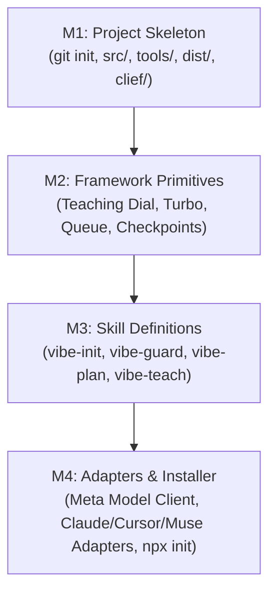

# FINAL — Independent Cross-Stream Synthesis for Phase 1

> **Independent Master Blueprint.** Synthesized independently across 6 contributor model runs (`google-gemini-3.8-flash`, `google-gemini-4-argon`, `muse-spark`, `ollama-launch-deepseek-v4.1-flash`, `ollama-launch-minimax-m3.1-flash`, and `openai-gpt-6`). Contains the definitive settled decisions, resolved contradictions, concrete milestone actions, and the hackathon submission strategy for `vibe-fence`.

---

## 1. Executive Synthesis — What Phase 0 Proved

Phase 0 established that **harness design causally dictates coding agent output quality, safety, and user retention far more than marginal model weight upgrades**. The difference between a raw shell and a purpose-built Agent-Computer Interface (ACI) can swing benchmark resolution by 400% on identical model weights.

However, the empirical literature from 2024–2026 also delivers sharp warnings that overturn conventional developer folklore:
1. **The Declarative Fallacy:** Markdown instruction files (`AGENTS.md`, `CLAUDE.md`, `.cursorrules`) are advisory prompt text, not security boundaries. Models arbitrarily ignore them under high context loads, and untrusted instruction files represent an active indirect prompt-injection vector (>80% attack success in auto-approval modes). Real safety requires **deterministic, air-gapped client-side hooks and git checkpoints**.
2. **The "Less is More" Scaffolding Principle:** Factorial ablations prove that stacking scaffolding components greedily (Combinatorial Scaffold Interference) degrades performance; the "All-In" 5-component scaffold is beaten by proper subsets in every condition tested. **Tool execution and mechanical verification capture ~70% of total scaffold value**.
3. **Verification Beats Consensus:** Unaided intrinsic self-correction ("Are you sure? Critique your code") degrades reasoning and flips correct code to buggy code. Repeated sampling scales log-linearly *only* when filtered by an executable verifier. Compute must be spent on **execution (compiler/tests), not opinion (judges/debate)**.
4. **Teaching and Autonomy Are Orthogonal Axes:** Permission prompts do not provide safety—users approve 93% blindly, missing 1 in 3 malicious commands due to warning habituation. Autonomy ("Turbo") must be built on **containment, reversibility, and atomic checkpoints**, while Teaching must follow an **instructional fading dial (`max→silent`)** to prevent the Expertise Reversal Effect.
5. **Meta's Dual-Model Horizon:** Meta's Model API provides an integrated multi-modal stack: **Muse Spark 1.3** as the everyday companion and guardrail workhorse, **Muse Wonder 1.0** as the architectural planning escalation tier, and **Muse Image** for automatic zero-friction UI asset generation.

---

## 2. Settled Decisions (Closed for Phase 1)

These 12 architectural decisions hold across ≥3 independent contributors and primary literature. Phase 1 must implement them without re-debating.

| # | Settled Decision | Core Justification & Primary Evidence | Implementation Target |
|---|---|---|---|
| **S-01** | **`AGENTS.md` is a ≤400-Token Router, Not an Essay** | ETH Zurich empirical benchmark (arXiv:2602.11988) proved bloated narrative overviews cause -3% accuracy and +23% token cost. | Root `AGENTS.md` ≤ 150 lines, pointing to `.fence/rules/`. |
| **S-02** | **Progressive Disclosure is the Universal Context Primitive** | Loading metadata frontmatter (~50 tokens) at startup and injecting procedural bodies only on task match prevents "Lost in the Middle" attention degradation (Liu et al. 2024). | Anthropic `SKILL.md` format in `src/skills/`. |
| **S-03** | **4,000-Byte Truncation on Tool Outputs** | Raw compiler flags and terminal bloat pollute working memory; capping tool stdout/stderr at 4KB cuts token overhead by ~50% without losing diagnostic signal. | `src/framework/aci.ts` command pager. |
| **S-04** | **Mechanical Verification (`.fence/check`) Over Self-Assessment** | Reflexion (Shinn et al. 2023) demonstrated a jump from 67% to 91% on HumanEval when code is gated by compiler/test execution tracebacks. | Post-write verification loop in `src/framework/verifier.ts`. |
| **S-05** | **Pre-Commit Local Secret Blocking** | API keys committed to git history are compromised within 60 seconds; static regex checks must block commits locally before files reach disk or remotes. | Gitleaks pattern hook in `.fence/hooks/pre-commit`. |
| **S-06** | **Strict Framework Public Prefix Guard** | AI models regularly prefix service-role keys with `NEXT_PUBLIC_` or `VITE_` to bypass permission errors, exposing the entire database. | Static AST linter in `src/rules/sec-client-secrets.ts`. |
| **S-07** | **Mandatory Table-Level RLS & Ban on `USING (true)`** | AI-generated database migrations regularly leave tables wide open to the public `anon` key. | SQL migration parser in `src/rules/sec-database-rls.ts`. |
| **S-08** | **Instruction File Integrity Attestation** | External packages and malicious dependencies can overwrite `AGENTS.md` to hijack agent behavior (TrojanForge, AIShellJack). | SHA-256 hash validation in `tools/validate.ts`. |
| **S-09** | **Teachable Turbo Built on Checkpoint Containment** | Users approve 93% of permission prompts blindly. Safety comes from automated git snapshots (`checkpoint: [action]`) and `npx vibe-fence undo`, not prompts. | `src/framework/turbo.ts` & `src/framework/git.ts`. |
| **S-10** | **The 4-Tier Teaching Dial (`max → med → min → silent`)** | Cognitive Load Theory (Sweller) and the Expertise Reversal Effect (Kalyuga) prove static verbosity impairs experienced users. | Configurable dial in `.fence/config.json`. |
| **S-11** | **The Autonomous Issue Queue (`.fence/queue.json`)** | Dumping raw technical errors paralyzes non-technical users. Findings are structured as `issue → solution → plan` items that the agent resolves. | State backlog in `.fence/queue.json`. |
| **S-12** | **Multi-Modal Meta Model Pipeline** | Muse Spark 1.3 (voice & everyday triage) + Muse Wonder 1.0 (complex planning) + Muse Image (web assets) + Muse Code (runtime target). | `src/framework/meta-client.ts`. |

---

## 3. Contested Risks & Phase 1 A/B Evals

| # | Contested Question | Reading A | Reading B | Phase 1 Resolution Strategy |
|---|---|---|---|---|
| **C-01** | **Hook Surface Breadth** | Sprawling lifecycle hooks across every tool action (`minimax 01`). | Minimalist hooks to prevent high false-positive rates that trigger bypasses (`deepseek 01`). | Ship a minimal, zero-false-positive hook set (`PreToolUse` for secrets, destructive git, and root breakout). |
| **C-02** | **App Profile Rigor** | Static global severity across all projects (`gemini-3.8-flash 04`). | Dynamic severity scaling from `local` prototype to `public` production (`minimax 04`). | Ship `.fence/app-profile.json` starting at `local` (12 blocking rules) and scaling on demand. |
| **C-03** | **Teaching Dial Granularity** | Single global slider (`gemini-3.8-flash 05`). | 7-dimensional per-domain vector (`deepseek 05`). | Surface a single global slider in UI; store per-domain vector in `.fence/state/dial.json` underneath. |
| **C-04** | **Dependency Audit Blocking** | Hard block on `npm audit --audit-level=high` (`muse-spark 04`). | Warn-only for build-time devDependencies to prevent paralysis (`gpt-6 04`). | Block only if vulnerable package is in runtime `dependencies`; warn if in `devDependencies`. |
| **C-05** | **SAM 3.1 Capabilities** | Automatic full-screen UI component decomposition (`gemini-3.8-flash 06`). | Single-concept bounding box only; multi-concept input fails (`minimax 06`). | Restrict SAM 3.1 to interactive click-to-teach visual element inspection; never block code on it. |

---

## 4. Milestone Execution Plan (Phase 1 Scaffold)

---

### Milestone 1 (M1) — Project Skeleton & Build Plumbing

*Goal: Establish deterministic single-authority build pipeline (`src/ → dist/`) and canonical repository map.*

- [ ] **`git init` & Repository Authority:**
  - Initialize clean git repository.
  - Enforce `src/` as the sole editable authority; `dist/` is strictly disposable.
- [ ] **Deterministic Build Engine (`tools/`):**
  - Implement `tools/generate.ts`: Compiles source skills and rules into distribution targets (`AGENTS.md`, `.claude/`, `.cursor/`, `.windsurf/`).
  - Implement `tools/validate.ts`: Strictly asserts that `AGENTS.md` is ≤ 400 tokens, rule files are ≤ 200 lines, and JSON schemas validate.
- [ ] **Canonical Project Documentation (`docs/clief/`):**
  - Create `docs/clief/INDEX.md`, `ARCHITECTURE.md`, `BOUNDARIES.md`, and `PROGRESS.md` mirroring the proven Clief operational standard.
- [ ] **Core State Tree Template (`src/templates/.fence/`):**
  - Establish the baseline structure: `.fence/config.json`, `.fence/queue.json`, `.fence/state.json`, `.fence/invariants.md`.

---

### Milestone 2 (M2) — Framework Primitives

*Goal: Implement the core engine mechanics: the teaching dial, teachable turbo, issue queue, and verification loop.*

- [ ] **The Teaching Dial Engine (`src/framework/dial.ts`):**
  - Implements the 4 tiers (`max`, `med`, `min`, `silent`).
  - Implements hint-first pedagogical formatting for `max` (PNAS 2025 finding).
  - Handles `silent` by cleanly bypassing model calls (avoiding Meta Model API's HTTP 400 on `reasoning_effort: "none"`).
- [ ] **Teachable Turbo Contract (`src/framework/turbo.ts`):**
  - Auto-approves safe code edits, test execution, and standard package installs.
  - Enforces **Hard Tripwires**: halting execution on database drops, remote production pushes, billable API additions, and 2-strike failure loops.
- [ ] **Deterministic Checkpoint Engine (`src/framework/git.ts`):**
  - Executes `git add . && git commit -m "checkpoint: [action]"` immediately prior to multi-file edits.
  - Exposes single-command rollback: `npx vibe-fence undo`.
- [ ] **Silent Reflexion Verifier (`src/framework/verifier.ts`):**
  - Intercepts writes; runs `tsc --noEmit` and tests; feeds failure traces into context for exactly one auto-repair turn.
  - Caps stdout/stderr paged into context at 4,000 bytes.
- [ ] **Autonomous Issue Queue (`src/framework/queue.ts`):**
  - Manages `.fence/queue.json` (`issue → solution → plan`).
  - Formats findings as companion roadmaps rather than alarmist ticket lists.

---

### Milestone 3 (M3) — Canonical Skill Definitions

*Goal: Author runtime-agnostic, progressive-disclosure skills in `src/skills/`.*

- [ ] **`vibe-init` (`src/skills/vibe-init/SKILL.md`):**
  - Inspects repo, initializes git, writes locked `.gitignore`, deploys `.fence/`, outputs 3-second safety receipt.
- [ ] **`vibe-guard` (`src/skills/vibe-guard/SKILL.md`):**
  - Enforces the 18 objective rules from Stream 04:
    - `SEC-01`: Zero secrets in git history (Gitleaks pattern).
    - `SEC-02`: Banning `NEXT_PUBLIC_*SERVICE_ROLE*` client master keys.
    - `SEC-03`: Banning missing RLS or `USING (true)` database policies.
    - `SEC-04`: Strict runtime schema validation (Zod/Valibot) on all route handlers.
    - `DEP-01`: Pre-push build verification (`npm run build`).
    - `HYG-01`: Single package manager lockfile consistency.
- [ ] **`vibe-plan` (`src/skills/vibe-plan/SKILL.md`):**
  - Decoupled Architect Gate: Enforces writing a plain-English plan in `.fence/plans/` before multi-file edits.
  - Generates the **2-Option Teachable Fork Card** (Fast & Lightweight vs Robust & Scalable).
- [ ] **`vibe-asset` (`src/skills/vibe-asset/SKILL.md`):**
  - Uses Meta's **Muse Image API** to generate web assets (icons, hero graphics, open-graph banners) directly into `public/images/`.

---

### Milestone 4 (M4) — Adapters, Meta Integration & Installer

*Goal: Wire multi-runtime support, Meta Model API client, and publish the single-command CLI.*

- [ ] **Meta Model API Client (`src/framework/meta-client.ts`):**
  - Configures `muse-spark-1.3` as everyday companion voice and `muse-wonder-1.0` as planning/verification escalation tier.
  - Implements stateless encrypted reasoning replay (`POST /v1/responses`) to guarantee user code privacy.
  - Connects Muse Image and SAM 3.1 endpoints.
- [ ] **Multi-Runtime Adapters (`src/adapters/`):**
  - `src/adapters/muse-code.ts`: Reference adapter for Meta Muse Code CLI (`AGENTS.md`, `.agents/skills/`, hooks).
  - `src/adapters/claude.ts`: Claude Code adapter (`CLAUDE.md`, `.claude/skills/`, `.claude/settings.json`).
  - `src/adapters/cursor.ts`: Cursor adapter (`.cursor/rules/*.mdc`, `.cursor/hooks.json`).
  - `src/adapters/opencode.ts`: OpenCode CLI & TUI adapter.
- [ ] **Universal Installer (`tools/install.ts` / `bin/vibe-fence.ts`):**
  - Packages executable for `npx vibe-fence init` and `npx vibe-fence undo`.
  - Zero dependencies, instantaneous (< 3 second) setup.

---

## 5. Hackathon Submission Strategy (Meta Global AI Hackathon)

### 1. Positioning & Theme Alignment
- **Track:** Indie Developer Track.
- **Theme:** *Build for Your World* — "Democratizing software creation by making vibe-coding safe for non-technical creators."
- **Why this wins:** While other teams build toys, `vibe-fence` tackles the #1 barrier holding back millions of potential AI builders: the fear of getting hacked, leaking database keys, or catastrophically breaking their project.

### 2. The 3-Minute Demo Video Script (The "Visceral Delta")
- **Minute 0:00 – 1:00 (The Unfenced Disaster):**
  - A non-technical creator asks a raw coding agent to "add user profiles and a database".
  - The unfenced agent immediately generates code leaking `NEXT_PUBLIC_SUPABASE_SERVICE_ROLE_KEY` to the browser, fails to enable RLS, breaks the build on an unhandled promise, and leaves the user facing raw terminal stack traces.
- **Minute 1:00 – 2:00 (The vibe-fence Intervention):**
  - Creator runs `npx vibe-fence init` in 3 seconds.
  - The terminal outputs: `🛡️ vibe-fence active. Checkpoints enabled. Secrets shielded.`
  - Same prompt given to the agent.
  - `vibe-fence` intercepts the secret leak, takes an automated git snapshot, runs Muse Spark 1.3 to formulate a 3-bullet plan, and prompts the creator with the 2-Option Teachable Fork.
- **Minute 2:00 – 3:00 (Multi-Modal Polish & Ship):**
  - Muse Image generates a custom app logo and hero illustration directly into `public/images/`.
  - The creator activates Teachable Turbo; the harness runs silent Reflexion checks, verifies the build, and executes a clean deploy to Vercel.
  - Final screen: A fully functional, completely secure, live web application running in production.

---

## 6. Phase 1 Acceptance Verification Rubric

Before claiming Milestone 4 is complete, the scaffold must pass this automated test suite:

1. **Idempotence Test:** Running `npx vibe-fence init` 3 consecutive times in an existing repo produces zero file churn and identical git status.
2. **Secret Leak Interception:** An agent attempting to commit an AWS secret or `NEXT_PUBLIC_SERVICE_ROLE` is hard-blocked with exit code 1.
3. **Rollback Integrity:** Calling `npx vibe-fence undo` cleanly reverts the last agent modification without detached HEAD state.
4. **Token Budget Compliance:** `tools/validate.ts` asserts root `AGENTS.md` is strictly ≤ 400 tokens and zero skills exceed 250 lines.
5. **Meta Model Response Flow:** `src/framework/meta-client.ts` successfully exchanges stateless reasoning tokens with `muse-spark-1.3` on the Meta Model API.
