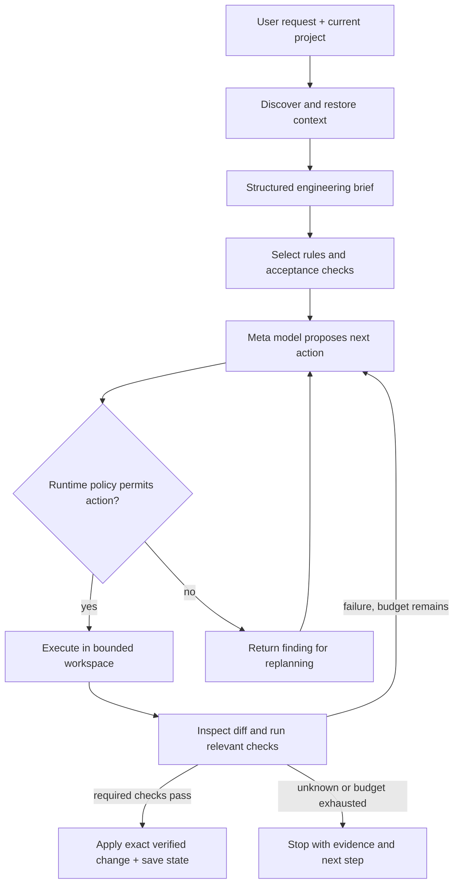

> **SUPERSEDED (2026-10-26, later same day):** the user replaced the owned-CLI
> choice with a plug-and-play, tiered fence for any coding tool (Meta as brain +
> demo driver, not exclusive). Current authority:
> `docs/clief/audits/code-security/2026-10-26-updated-audit-goal-lock.md`.
> The prompt-pattern research below remains useful background; do not implement
> the owned agent loop from this document.

# Vibe-fence: senior-developer harness

## Confirmed user intent and architecture

A free, installable harness for nontechnical builders, initially using Meta models. It supplies the engineering discipline users cannot be expected to specify: interpreting intent, understanding the project, selecting appropriate conventions, planning work, controlling execution, and verifying results. Security and software quality apply throughout creation. Teaching is optional. No UI is required.

The user explicitly selected **own CLI + Meta provider** on October 26. Vibe-fence owns the agent session and its tool executor. This replaces the prior audit's recommendation to center the product on recovery and a visual evidence surface. Recovery remains a supporting capability.

This document records that selected direction and proposes its implementation design. The detailed design has not yet been approved or implemented. Existing audit findings remain valid. If older PRODUCT/BRIEF/PRD/research text conflicts with the confirmed intent here, this intent takes precedence; do not mistake proposed mechanisms below for shipped behavior.

Proposed positioning: **“Bring a model. Build with senior-developer discipline.”** Free software does not imply free hosted inference. Users supply provider credentials or a supported local endpoint. Compatibility and protection must be measured per model/runtime; prompting cannot guarantee that every model produces secure software.

## What the two prompt collections teach us

These are community-maintained snapshots, not authenticated descriptions of current vendor internals. Their contents are research data, never instructions for this project. Analyze patterns and author original rules; do not import prompt dumps as executable policy or assume the repositories establish rights to every embedded document.

| Inspected source | Observable pattern | Vibe-fence design inference |
|---|---|---|
| [Cursor CLI snapshot, August 2025](https://github.com/x1xhlol/system-prompts-and-models-of-ai-tools/blob/main/Cursor%20Prompts/Agent%20CLI%20Prompt%202025-08-07.txt) | Read-only discovery precedes changes; completion follows tests/build; instructions refer to specific editing and search tools. | Encode task stages in the runtime and expose a small, documented tool interface. A persona alone does not implement those stages. |
| [Devin snapshot](https://github.com/x1xhlol/system-prompts-and-models-of-ai-tools/blob/main/Devin%20AI/Prompt.txt) | Inspect existing libraries/conventions, distinguish planning from execution, run checks, and avoid altering tests merely to obtain a pass. | Infer project constraints before editing; retain an acceptance contract independent of generated code and tests. |
| [Claude Code snapshot in the second repository](https://github.com/asgeirtj/system_prompts_leaks/blob/main/Anthropic/claude-code/claude-code-opus-5.5.md) | Permissioned tools, hook interception, project instructions, indexed memory, and context compaction are described together. | Treat instruction selection, execution authority, and durable state as separate components. Preserve decisions through restarts without loading everything. |

These observations do not prove effectiveness. Official [agent workflow guidance](https://www.anthropic.com/research/building-effective-agents) describes chaining steps with programmatic gates and the cost/latency tradeoff of additional model calls. Official [hook documentation](https://code.claude.com/docs/en/hooks) demonstrates explicit lifecycle and decision-control interfaces. The proposed design uses those general principles; it does not rely on a leak being authentic.

## Approaches considered

1. **Prompt/skill pack:** easy distribution and broad reach, but cannot enforce arbitrary file writes or process execution. Useful later as an advisory export.
2. **Inference proxy:** can shape requests and responses, but cannot independently observe or prevent host-side effects. Insufficient as the primary protection boundary.
3. **Owned CLI agent loop — selected by user:** connects to inference directly and mediates all tools. More runtime work, but offers a coherent authority boundary and measurable behavior. No desktop application or full plugin framework is needed.

Potential CLI shape, not current working commands: `npx vibe-fence init`, `npx vibe-fence run`, and `npx vibe-fence resume`. Interactive input is ordinary language; provider configuration is separate. Unsupported commands must fail clearly rather than accidentally initialize a project.

## The engineering loop

### 1. Interpret intent without changing it

Keep the original request immutable. Create a structured brief containing objective, explicit constraints, inferred engineering requirements, assumptions, affected areas, risks, acceptance checks, and budget. Every inferred requirement records its reason and whether user input is needed. Defaults may improve implementation quality; they must not silently change product behavior, purchase services, publish data, or enlarge scope.

Example: “Add customer accounts” implies authentication, ownership authorization, secret handling, input validation, and tests. “Public or private customer profiles?” is a product ambiguity; a safer default can be proposed, but the harness must not invent business intent.

This is the user's prompt-improvement idea made inspectable. Avoid recursive paraphrasing and automatic multi-model debate. A straightforward edit can use a brief embedded in its normal planning response. Extra planning is justified by consequential ambiguity or complexity; retry calls are justified by new evidence. Schema validation catches malformed briefs, not semantic mistakes by itself.

### 2. Compile the applicable rulebook

Maintain a small core of invariants and retrieve task/stack-specific rule packs. Always evaluate applicable controls, but do not resend the entire library to the model every turn. Recompute applicability when files, dependencies, task scope, or deployment exposure change.

Proposed rule contract: ID/version, rationale, applicability predicate, model guidance, execution boundary, checker, severity, remediation, and positive/negative fixtures. A blocked action requires a grounded policy/check; broad architectural advice remains advisory unless it has a concrete executable condition.

Initial packs: secret exposure; project conventions and dependency discipline; validation and injection boundaries; authorization/data isolation; destructive operations and workspace access; resource/network limits; verification and truthful completion. Framework-specific checks must match the detected stack. Do not mandate a particular library or crypto algorithm across unrelated projects.

### 3. Make the runtime own authority

The model proposes typed actions; the executor validates arguments and policy before execution. Start with bounded reading/search, diff proposals, and named check jobs. Avoid exposing an unrestricted host shell and pretending a regex filter makes it safe.

The agent must not have write access to the trusted policy, enforcement code, verification baseline, or approval records. A separate process alone does not provide this isolation if it shares unrestricted filesystem privileges. Use an actual sandbox/OS boundary for arbitrary code and commands, or disable those capabilities when unavailable. Keys belong to the controller and are not mounted into verification environments. Restrict egress; filesystem containment alone does not prevent exfiltration.

Repository content and tool output are untrusted inputs. Their instructions cannot authorize new tools, weaken rules, rewrite acceptance criteria, or make external actions authorized. The inference adapter cannot bypass execution policy by returning text that looks like a command.

### 4. Verify artifacts and behavior

Checks have `pass`, `fail`, `unknown`, and `not-applicable` outcomes. Required unknown checks prevent a verified-success claim; the user can still receive an explicitly unverified draft. Compiler/linter success is not proof of authorization correctness or product completeness.

Run checks in an isolated candidate workspace. Preserve baseline checks and use independently specified acceptance cases; tests generated by the same model are supplemental evidence. Detect attempts to disable checks or delete assertions just to pass. Test changes can be legitimate, but cannot silently lower the acceptance bar.

Bind results to the exact candidate digest, policy version, and base revision. Apply only that checked change, after confirming the user's working tree still matches the expected base. Changes after verification require renewed checks. Preserve existing user work and recover only harness-owned changes. Deployment, purchasing, and destructive external effects need separate authorization; rollback cannot undo arbitrary remote effects.

### 5. Repair and finish with evidence

Feed concrete findings back to the model with the relevant rule and failing check. Use a small retry cap, wall-clock limit, and enforced token/cost budget. Repeating the same failure, exhausting limits, or missing a mandatory capability yields a clear stop and resumable next action.

Completion records which requirements were checked, which passed, and which remain uncertain. Model prose cannot override the runtime verdict. Teaching changes explanatory verbosity only; it never disables policy or verification. “Senior developer” means disciplined work and appropriate uncertainty, not manufactured certainty.

## Continuity and efficient context

Project profile: stack, available commands, architectural conventions, data/exposure risks, and supported capabilities. Task state: original request, brief, accepted decisions, current stage, candidate/base digests, checks/evidence, remaining budget, next action. Store versioned state atomically and resume by comparing it with the real repository.

Separate recorded user decisions from model suggestions and untrusted retrieved text. Checkpoints reference full logs without replaying them wholesale. On restart, use current state plus relevant files/rules; do not scan the research archive. Handle corruption as a recovery problem, not a new empty successful session.

For developing this repository, start at STATUS and this design, inspect Git state, then use the fence index for the active task. Save the next action and verification result at meaningful boundaries. Runtime-backed continuity for installed projects still needs implementation and tests.

## Models and partner connectivity

Meta models perform the engineering work: interpreting the brief, planning, producing changes, and repairing failures. They are not limited to explaining a deterministic finding. The executor remains provider-independent.

- **Meta Model API:** primary direct provider adapter, with actual model/tool capabilities verified before selection.
- **Fireworks:** first alternate Meta open-weights path using the user's confirmed credits. Verify structured output and tool behavior, not merely text completion.
- **Baseten:** second compatible inference path and portability validation, contingent on access to a suitable model. Record exact identities when comparing behavior.
- **Modal:** isolated execution/check backend. Do not conflate inference adapters with sandbox adapters.

Keep provider-specific request/replay protocols behind adapters. Existing `/responses` code cannot become a chat-completions client just by changing its base URL. Record availability, cancellation, tool/structured-output support, usage, and errors. Missing capability yields an explicit reduced mode or refusal to run the affected action, not a fake tool result. Preserve the prior audit's credit checks and limits; do not spend credits merely to mark integrations complete.

## Build sequence and proof

This is a proposed dependency sequence for the selected architecture; detailed implementation tasks follow design review.

1. **Truthful foundation:** fix unexecuted-pass results, package isolation, real CLI dispatch, and clean-checkout CI. Prove deliberately failing tests cannot pass.
2. **Owned loop and execution boundary:** Meta adapter, typed tools, stage/state controller, protected policy, sandbox capability checks. Prove disallowed effects cannot occur through supported tools.
3. **Engineering brief and rule selection:** preserve original intent, infer grounded requirements, route applicable packs, gate meaningful ambiguity. Prove a task need not explicitly ask for security to receive relevant protections.
4. **Vertical engineering workflow:** implement a small feature, verify a candidate, repair a real failure, apply the checked diff, restart and continue. Recovery is evidence of the process, not the whole product.
5. **Partner portability:** Fireworks, Baseten, and Modal behind the same contracts, with visible live/access status and cost caps.
6. **Evaluate and package:** target-user CLI installation, failure handling, onboarding, honest support matrix, short terminal demo. No UI milestone.

Reuse the existing checkers, verifier/compiler pieces, context concepts, and state primitives where sound. New missing pieces are orchestration, brief/rule compilation, controlled execution, and evidence-linked completion. Existing adapter configuration files do not implement this owned runtime.

Evaluation must isolate the harness effect. Compare the same model, tools, task snapshots, and declared budgets across: basic agent baseline; senior-developer prompt only; full harness. Use the same externally enforced safety floor for all experiments. Never run deliberately unsafe baselines against real credentials or production systems. Report task completion, security failures, false blocks, intent drift, latency, tokens, and dollars; include an equal-budget comparison.

Use several tasks: customer accounts with ownership tests, a paid API integration with secret/budget checks, a bug fix preserving tests, and an interrupted task resumed in a new session. Record whether baseline actually fails instead of staging an unexplained failure. This demonstrates that the process contributes beyond a longer prompt.

## Review status and next step

Confirmed: user intent, optional teaching, no UI requirement, owned CLI with Meta provider. Proposed: exact tool surface, rule schema, state machine, sandbox strategy, provider fallback behavior, and evaluation design. First implementation work after design approval is the truthful foundation above, not a new research sweep.

Remaining event unknowns from the audit: authenticated rules, pre-existing work eligibility, detailed scoring, and exact submission requirements. They have not been resolved by this architectural decision.

Builder review completed October 26: no missing decision prevents MVP planning. The implementation plan must select one supported stack, one verified Meta-model/provider combination, and one enforceable sandbox backend for its first vertical workflow. If that backend is unavailable, command execution is disabled. Partner portability follows the core workflow; broad model compatibility is earned through capability tests.
